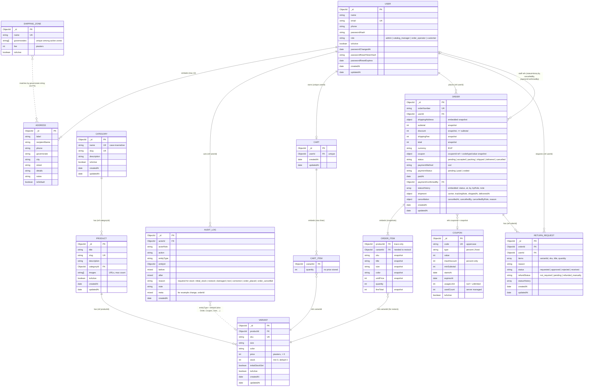

# ERD (Entity Relationship Diagram)

Status: final for the MVP (P1-T08, reviewed 2026-11-24). The details of each entity are in `data-model.md`. Order and payment states are drawn in `order-state-machine.md` (P1-T09).

Tool: Mermaid (plain text in git, renders in VS Code and GitHub).

## Rules used to choose embed vs reference
Sources: MongoDB Manual (Embedded Data, Reference Data, Atomicity, Data Modeling Best Practices).

Ask these questions for every relationship:
1. Is the child always read together with the parent? Leans to **embed**.
2. Is the child count bounded and small? If it can grow without limit, **reference**.
3. Is the child queried on its own? **Reference**.
4. Does the child change often and must stay one single truth? **Reference**.
5. Must the child change atomically with the parent? **Embed**.
6. Is the child a snapshot of a moment in time (for example an order line)? **Embed**, as a frozen copy.

## Diagram
Legend: `PK` primary key, `UK` unique, `FK` reference to another collection. Embedded children are marked in the relationship label. Solid line = stored link (embedded or `ObjectId` reference). Dashed line = no stored foreign key (matched by value, or a polymorphic link).

