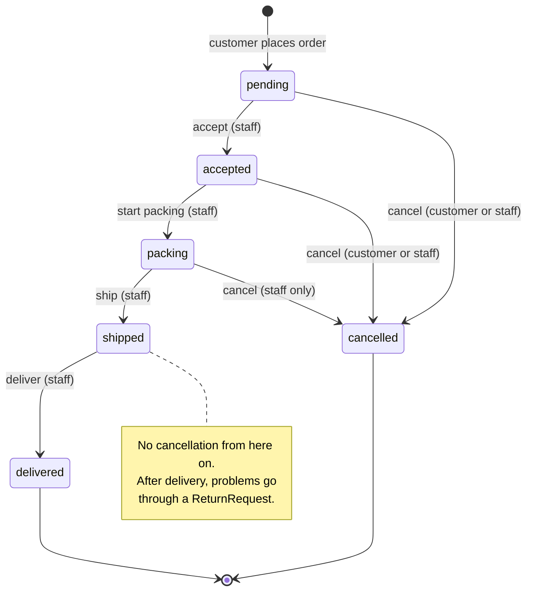
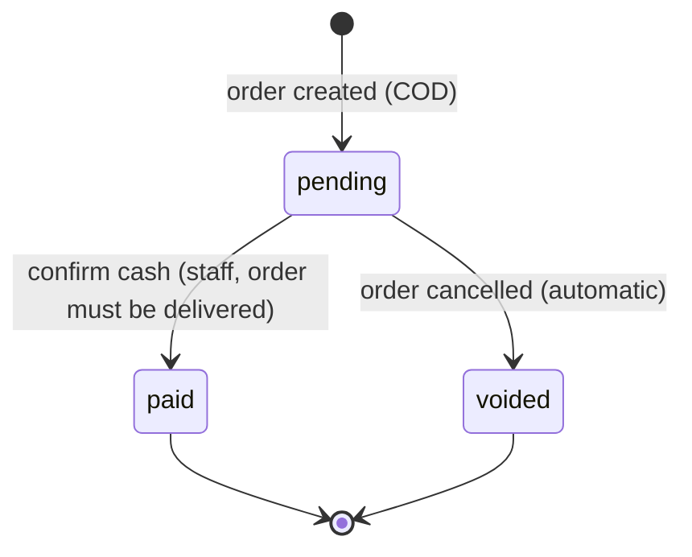

# Order and payment state machines

Status: final for the MVP (P1-T09, reviewed 2026-11-25). Built on `data-model.md` (Order) and `docs/02-decisions.md` ("Order flow").

Tool: Mermaid `stateDiagram-v2` (syntax checked in the Mermaid docs through Context7: `[*]` start/end, `A --> B : label`, notes).

## Core rule
**Whitelist.** Only the transitions in the tables below exist. Anything not listed (skipping a step, going back, leaving a final state, moving to the same state) is rejected with `409`. The server owns the state: the client never sends a target status it can pick freely; it calls an action, and the server checks it against the table.

There are **two separate machines** on one Order document:
- `status`: the fulfilment journey (logistics).
- `paymentStatus`: the money (COD now, a gateway later).

They are linked by guards (for example "payment can be confirmed only when the order is `delivered`"), not merged into one field. Reason: a future online payment changes the payment machine without touching fulfilment.

---

## 1. Order status

### Diagram

"Staff" in this file means **admin and order operator** only. The catalog manager has no order permissions (decisions, "Permissions").

### Labels (brief section 08: human-readable status labels)
| Code | Label for customers and staff |
|---|---|
| `pending` | Awaiting confirmation |
| `accepted` | Confirmed |
| `packing` | Being prepared |
| `shipped` | Out for delivery |
| `delivered` | Delivered |
| `cancelled` | Cancelled |

The code is what is stored and what the API logic uses. The label is display text, kept in **one map on the server** and returned next to the code (for example `status` and `statusLabel`). An Arabic label set can be added to the same map later without touching the stored data.

### Final states
`delivered` and `cancelled` are final. Nothing leaves them. A return after delivery is a separate entity (ReturnRequest) and never changes the order status or its payment history (brief section 06).

### Transition table
Every row also appends one `statusHistory` entry `{ status, at, by, byRole, note }` and sets `updatedAt`. Those two are not repeated in the side-effects column.

| # | From | To | Who | Guard (checked on the server) | Side effects |
|---|---|---|---|---|---|
| T0 | (none) | `pending` | customer | cart valid, stock and coupon available (P5) | `paymentStatus = pending`; stock deducted per item; coupon `usedCount + 1`; cart cleared; one stock audit entry per variant (reason `order_placed`). All in one transaction. |
| T1 | `pending` | `accepted` | admin, order operator | status is still `pending` | audit `order_status_changed` |
| T2 | `accepted` | `packing` | admin, order operator | status is still `accepted` | audit `order_status_changed` |
| T3 | `packing` | `shipped` | admin, order operator | status is still `packing` | `shipment.shippedAt = now`; optional `shipment.carrier`, `shipment.trackingNote`; audit `order_status_changed` |
| T4 | `shipped` | `delivered` | admin, order operator | status is still `shipped` | `shipment.deliveredAt = now` (this also starts the return window); audit `order_status_changed`. **Payment does not change here** (see section 2). |
| T5 | `pending` | `cancelled` | customer (own order), admin, order operator | status is still `pending` | see "Cancellation side effects" |
| T6 | `accepted` | `cancelled` | customer (own order), admin, order operator | status is still `accepted` | see "Cancellation side effects" |
| T7 | `packing` | `cancelled` | admin, order operator | status is still `packing` | see "Cancellation side effects" |

### Cancellation side effects (T5, T6, T7)
All in **one transaction**, and the status update is the **first** step (it decides if the cancel is allowed at all):
1. Conditional update. The filter is `_id` **and** `status` in the states this actor may cancel from (customer: `pending`, `accepted`; staff: `pending`, `accepted`, `packing`), **and** for a customer also `userId` = the user from the token (ownership inside the write). The update sets `status = cancelled`; set `cancellation { cancelledAt, cancelledBy, cancelledByRole, reason }`; push the `statusHistory` entry.
2. `paymentStatus` from `pending` to `voided` (section 2, P2).
3. Stock restored: `$inc +quantity` on each `items.variantId`, with one stock audit entry per variant (reason `order_cancelled`, `meta.orderId`).
4. If the order has a coupon: `usedCount - 1` on `coupon.couponId`.
5. Audit `order_status_changed` and `payment_status_changed`.

If step 1 matches nothing, the transaction is aborted and **nothing** in steps 2 to 5 runs. This is what stops a double-click "cancel" from restoring the stock twice.

**Careful: "matches nothing" is not an error by itself.** A conditional update that matches no document just returns `null` (or `matchedCount: 0`); MongoDB does not abort anything on its own. The service must check the result and **throw** (`404` or `409`, see "Order of checks"). Throwing inside `connection.transaction()` / `session.withTransaction()` is what aborts the transaction (Mongoose docs, Transactions; `Connection.prototype.transaction()`, Mongoose 8.x). If the code forgets to throw, steps 2 to 5 run anyway and the stock is restored for an order that was never cancelled.

**Two cancels at the same time inside transactions:** the second transaction to touch the same order gets a write conflict, a `TransientTransactionError`. The helper retries it automatically; on the retry, the filter no longer matches (the order is already `cancelled`), so the service throws `409` and nothing is restored twice.

Reason field: **required for staff** (accountability: the customer must be told why), **optional for the customer**.

### Rejected examples (all `409`, the order is not changed)
- `pending -> shipped` (skipping steps).
- `shipped -> packing` (going back).
- `shipped -> cancelled` or `delivered -> cancelled` (too late; returns instead).
- `cancelled -> pending` (leaving a final state).
- `shipped -> shipped` (same state, for example a second "ship" click).
- A customer cancelling a `packing` order: the customer has the right to call cancel, but the state does not allow it, so it is `409`, not `403`.

### Order of checks on every transition endpoint
`401` no or bad token -> `403` wrong role (for example a customer on an admin route, or a catalog manager) -> `400` invalid input -> `404` order not found **or not the customer's own** -> `409` wrong state. Ownership comes before the state check so a customer never learns anything about another user's order.

---

## 2. Payment status (COD)

### Values
| Code | Label | Meaning |
|---|---|---|
| `pending` | Payment due on delivery | the order exists; money not collected yet |
| `paid` | Paid | cash was collected and confirmed by staff |
| `voided` | Not charged (order cancelled) | the order was cancelled before any money was collected; nothing is owed |

**Why `voided` and not "leave it `pending`" for a cancelled order:** `pending` means "money is still expected". Reports such as "cash still to collect" or the sales summary (P7-T02) would count a cancelled order as owed money. A cancelled COD order owes nothing, so it gets its own final value.

**Why no `refunded` value:** `paid` happens only after `delivered`, and an order can never be cancelled after `shipped`. So "paid and then cancelled" cannot happen in this machine. Money returned after a return request is tracked in `ReturnRequest.refundStatus` (`refunded_manually`), not on the order, so the order keeps its payment history untouched. A gateway (deferred) would add values like `failed` and `refunded` later.

### Diagram

### Transition table
| # | From | To | Who | Guard | Side effects |
|---|---|---|---|---|---|
| P0 | (none) | `pending` | system, inside T0 | `paymentMethod = cod` | none extra |
| P1 | `pending` | `paid` | admin, order operator | order `status = delivered` **and** `paymentMethod = cod` **and** `paymentStatus` is still `pending` (all three in the update filter) | `paidAt = now`, `paymentConfirmedBy = staff id`; audit `payment_status_changed` |
| P2 | `pending` | `voided` | system, only as step 2 of a cancellation | order is being cancelled in the same transaction | audit `payment_status_changed` (in the cancellation transaction) |

`paid` and `voided` are final. There is no endpoint that sets `voided` directly.

### Decision: separate "confirm payment" action, not automatic on `delivered`
P6-T03 asked to choose. Chosen: **a separate action** (`POST /api/v1/admin/orders/:id/mark-paid`), allowed only after `delivered`.

| Option | For | Against |
|---|---|---|
| **A. Set `paid` inside T4 (deliver)** | one click, no "delivered but unpaid" orders | mixes a logistics fact with a money fact; assumes the cash reached the shop the moment the parcel arrived; `paymentConfirmedBy` is just whoever pressed "deliver" |
| **B. Separate action after `delivered` (chosen)** | two facts, two actors, two audit entries; staff can list "delivered but not yet paid" to chase the courier's cash; the same shape works for a gateway later | one more step for staff |

This matches the decision "COD becomes `paid` at `delivered`, set by an order operator or admin": it can only happen **from** the `delivered` point, by those roles.

**Where payment history lives:** `paidAt`, `paymentConfirmedBy` and the audit log. `statusHistory` stays for the order status only.

---

## 3. Concurrency: two operators press "ship" at the same time
**What must happen:** exactly one wins. The order is shipped once, with **one** `statusHistory` entry, **one** `shippedAt`, **one** audit entry. The other operator gets `409` ("the order is no longer in `packing`; current status: `shipped`").

**Why "read, check, then save" is wrong:** both requests read the order, both see `packing`, both pass the check in JavaScript, both save. Result: two history entries, two audit entries, and the second save silently overwrites the first `shippedAt`. This is a **race condition** (check-then-act).

**The fix: put the check inside the write.** One conditional update whose filter contains the expected state: "find the order with this `_id` **and** `status: packing`, then set `shipped`, set `shippedAt`, push the history entry". A single-document write in MongoDB is atomic (MongoDB Manual, Atomicity and Transactions), so only the first request matches. The second finds no document in that state and gets nothing back. Then the service reads the order once more only to choose the answer: not there (or not yours) -> `404`; there but in another state -> `409`.

The same pattern protects every row in both tables:
- "Customer cancels while the operator ships": whichever write lands first wins; the other gets `409`. If the cancel loses, its transaction aborts and no stock is restored.
- "Two clicks on mark-paid": the filter is `status: delivered` and `paymentStatus: pending`; the second click gets `409`, `paidAt` is not overwritten.

This is the base for P6-T02 (transitions), P5-T05 / P6-T04 (cancellation) and P6-T03 (mark paid).

---

## 4. What this file leaves to later tasks
- Endpoint shape for transitions (one `PATCH .../status` reading the table, or one route per action): P6-T02. Either way the table above is the single source of truth, kept in one place in the orders module.
- Whether a plain transition (T1 to T4) writes its audit entry in a transaction with the status update: P6-T02 (recommended: yes, so a status change never exists without its audit entry).
- Known gap, accepted for the MVP: a COD customer who refuses the parcel at the door has no path (`shipped` cannot be cancelled). A future `delivery_failed` state (with restock) is the usual answer; it is not in the brief's status list, so it waits until after the MVP.
